# Palette Studio

웹 UI의 색상·스타일·폰트·아이콘·컴포넌트 표현을 선택하고, 선택 결과를 CSS·JSON·에이전트 작업지시로 내보내는 오프라인 HTML 도구입니다. 특정 프레임워크에 종속되지 않습니다.

## 실행

[Palette Studio 작업실](https://wontaejeong.github.io/palette-studio/)을 열거나, 저장소의 `index.html`을 브라우저에서 여세요. 별도의 서버나 설치가 필요하지 않습니다. `START-HERE.html`은 폰트까지 내장한 단일 파일이며 다른 폴더로 옮겨도 동작합니다.

기본 화면은 **하나의 디자인 작업실**입니다. 왼쪽에서 세트를 고르고 색상·형태·글꼴·배치·움직임·컴포넌트·아이콘을 조정하면 오른쪽의 프로젝트 미리보기에 바로 반영됩니다. 기능별 탭이나 다른 편집 화면으로 이동할 필요가 없습니다. 모바일에는 선택한 디자인의 축소 미리보기와 확대 버튼을 제공합니다.

상단 **확인 · 내보내기**에서 프로젝트 이름, 적용 범위와 프레임워크를 확인하고 모든 산출물을 생성합니다. 각 선택과 파일은 하나의 설정을 공유하며 브라우저와 CLI는 동일한 생성기를 사용합니다.

기존 `catalog.html`과 `handoff.html`은 예전 링크 호환과 독립 실행을 위해 유지합니다. `icons.html`은 SVG 표현·코드 복사·개별 저장이 필요한 경우 사용하는 독립 아이콘 브라우저입니다. 예전 팔레트·도감·핸드오프 선택 링크의 설정은 작업실에서도 읽을 수 있습니다.

GitHub Pages는 `main` 브랜치의 루트 디렉터리를 배포합니다.

## 기능

### 디자인 세트와 컴포넌트 도감

- 6개 세트: 기본 프로젝트, 설정·개인화, 입력·승인, 문서·콘텐츠, 운영·데이터, 상태·알림.
- 세트 선택 시 팔레트·스타일·본문/코드 폰트·컴포넌트 기본 표현을 적용합니다.
- 19개 요소를 한국어 설명, 정식 이름, 영문 이름, 용도로 검색할 수 있습니다.
- 입력·피드백·오버레이·탐색·콘텐츠로 분류합니다.
- 요소별로 기본 배경 / 윤곽선 / 강조색 표현을 선택합니다. 세트를 다시 고르면 개별 표현이 초기화됩니다.
- 알림, 확인창, 드로어, 입력, 스위치, 체크박스, 탭, 페이지 이동, 접기 등의 동작을 확인할 수 있습니다.
- 모든 프리셋·요소·배치·애니메이션은 Light/Dark를 나란히 표시합니다. 도구 자체의 라이트/다크 설정은 별도로 저장하며 내보내는 프로필에 포함하지 않습니다.
- 프리셋마다 권장 팔레트 3개와 권장 요소 5~6개, 기본 메뉴 배치·애니메이션·요소별 표현을 지정합니다. 권장 요소만 표시할 수 있으며 전체 목록도 사용할 수 있습니다.
- 메뉴 배치는 상단 / 좌측 / 상단+좌측 3종입니다. 메뉴 크기와 모바일 드로어 전환 기준을 작업지시에 포함합니다.
- CSS 애니메이션은 전환 없음(0ms) / 빠른 전환(120ms) / 기본 전환(180ms) / 긴 전환(260ms) 4종입니다. 페이드·이동·확대·펼치기 시연과 CSS 저장을 지원하며 동작 줄이기 설정을 따릅니다.
- 선택은 로컬 저장소와 URL fragment에 저장합니다. 공유 링크는 같은 키트 파일에 접근할 수 있는 환경에서 선택을 복원합니다.
- 생성된 작업지시에는 선택 프로필, 범위별 실제 색상 HEX, 스타일 수치, 요소별 표현과 동작 기준을 포함합니다.

| 분류 | 요소 |
|---|---|
| 입력 | Button, Text field, Select, Switch, Checkbox |
| 피드백 | Toast, Alert |
| 오버레이 | Dialog, Drawer, Tooltip, Popover |
| 탐색 | Dropdown menu, Tabs, Breadcrumb, Pagination |
| 콘텐츠 | Card, Badge, Accordion, Empty state |

### 독립 콘셉트와 실제 UI 라이브러리

- 세트와 별도로 미니멀(Minimal), 소프트(Soft), 에디토리얼(Editorial), 컴팩트(Compact), 브루탈리스트(Brutalist), 글래스(Glass), 익스프레시브(Expressive), 터미널(Terminal), 택타일(Tactile) 9종을 비교합니다. 실제 컴포넌트의 형태·위계·경계·깊이·간격이 달라지며 선택한 본문/코드 폰트는 유지합니다.
- 기존 UI/Vanilla와 Base UI, Radix Primitives, React Aria, MUI, Mantine을 선택합니다. 별도의 실제 라이브러리 영역은 로컬에 번들한 패키지의 Button·Tooltip·Dialog·Popover·알림을 실행합니다. 일반 프로젝트/도감 예시는 프레임워크 중립입니다.
- Radix·React Aria 알림은 Sonner 보조 런타임입니다. shadcn/ui는 Base UI/Radix 기반으로 복사해 관리하는 레시피이며 독립 런타임으로 설치하지 않습니다. 선택은 기존 앱의 라이브러리 교체를 승인하거나 대상 프레임워크를 자동 변경하지 않습니다.
- 라이브러리 카드의 **지표 새로고침**을 누르면 공개 GitHub REST와 npm 다운로드 API를 조회합니다. 초기 메트릭 요청은 0건이며 인증·서버가 필요 없습니다. 소스별 정상 값을 1시간 캐시하고, 부분 실패 시 이전 값·실패·조회 시각을 함께 표시합니다.
- Stars는 저장소 관심도이며 monorepo 전체일 수 있습니다. npm은 명시된 대표 패키지의 `last-week` 응답 기간 다운로드이며 CI·반복 설치를 포함합니다. Radix는 `@radix-ui/react-dialog`, shadcn은 `shadcn` **CLI 다운로드**입니다. 고유 사용자 수·품질 순위·전체 설치 기반이 아닙니다. 검증 패키지 버전과 저장소의 최신 정식 릴리스(초안·사전 릴리스 제외)는 구분됩니다.
- 라이브 지표는 선택 프로필·공유 URL·내보내기 파일에 포함되지 않습니다. 지표 조회가 차단되어도 오프라인 미리보기·내보내기는 동작합니다.

### 팔레트·스타일·폰트

- 32개 팔레트 × Light/Dark 2개 모드.
- 색상과 독립적인 6개 스타일: Operational, Soft, Outline, Editorial, Compact, Clear Boundaries.
- OFL 폰트 24종: 본문용 15종, 코드용 9종. 역할별 검색·한글 지원·글자 견본·라이선스를 확인합니다.
- 폰트 공급: 버전이 고정된 CDN 우선 / 동봉 파일 / 시스템 폰트. CDN 실패 시 동봉·시스템 폰트로 폴백합니다.
- 같은 프로젝트 UI에서 두 팔레트 비교, 데스크톱 고정 미리보기, 모바일 미리보기 확대.
- 새 앱/기존 앱 및 Light+Dark / Dark only / Light only 적용 범위 선택.

### 아이콘

- Lucide SVG 95개. 이름·한국어 검색과 카테고리 필터.
- Outline / Accent / Duotone / Filled tile 표현, 크기·선 두께 조정.
- 선택 팔레트의 Light/Dark 미리보기, SVG 복사·다운로드.
- [React 패키지](packages/icons-react)는 정적 named export, TypeScript, SSR, 접근성 속성을 지원합니다. npm 레지스트리에 공개된 패키지가 아니며 로컬 tarball로 사용합니다.

### 에이전트 핸드오프

작업실 상단의 **확인 · 내보내기**를 열어 프로젝트 이름, 기존/신규 앱, 색상 적용 범위, 레이아웃 목적, React/Vanilla/Astro와 폰트 공급 방식을 확인합니다. 아이콘과 디자인 선택값은 편집 중인 설정 그대로 전달됩니다.

| 산출물 | 내용 |
|---|---|
| `handoff-config.json` | 브라우저와 CLI에서 사용할 입력 설정 |
| `design-profile.json` | 선택값과 제약을 담은 기계 판독 프로필 |
| `design.md` | 프로젝트 디자인 기준과 적용 규칙 |
| `selected-theme.css` | 선택한 팔레트와 허용된 모드의 색상 토큰 |
| `selected-style.css` | 반경·간격·높이 등 스타일 변수 |
| `selected-motion.css` | 선택한 애니메이션과 동작 줄이기 규칙 |
| `selected-fonts.css` | 본문·코드 폰트와 공급 정책 |
| `AGENT-TASK.md` | 요소별 선택과 구현 동작을 포함한 작업지시 |
| `QA-CHECKLIST.md` | 상태·키보드·반응형·테마 검증 항목 |

브라우저에서는 개별 파일을 저장합니다. CLI는 선택한 SVG·WOFF2·라이선스와 검증 스키마도 함께 저장합니다. 기존 설정은 그대로 사용할 수 있으며, 도감 선택은 `designSelection` 필드로 추가됩니다. 브라우저와 CLI는 `data/handoff-core.js`의 생성 함수를 공유합니다.

```bash
node scripts/create-design-handoff.cjs --config handoff-config.json --out design/handoff
node scripts/create-design-handoff.cjs --config handoff-config.json --out design/handoff --check
```

`--check`는 파일을 수정하지 않고 생성 결과와 기존 파일의 차이를 검사합니다.

## 현재 화면

다음 캡처는 현재 HTML을 오프라인 Chromium에서 실행해 생성합니다. 이미지와 UI 소스의 해시는 `previews/screenshots.json`에 기록합니다.

| 통합 작업실 · Light | 통합 작업실 · Dark |
|---|---|
| 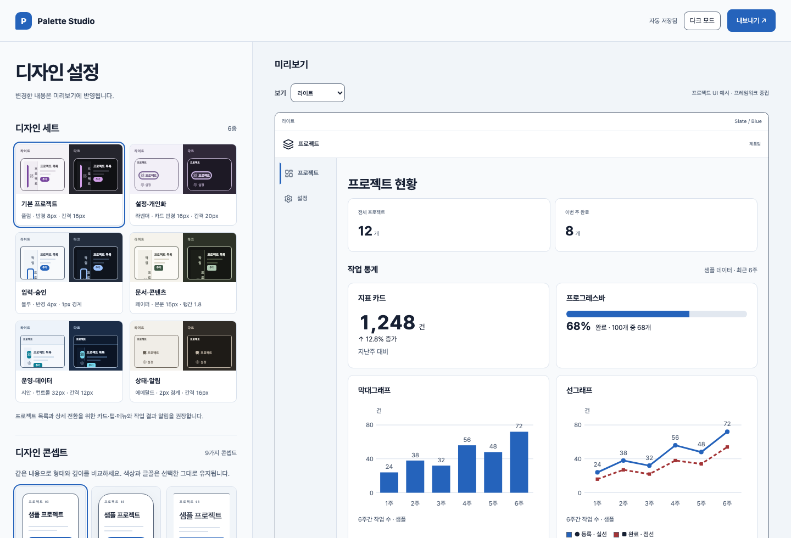 | 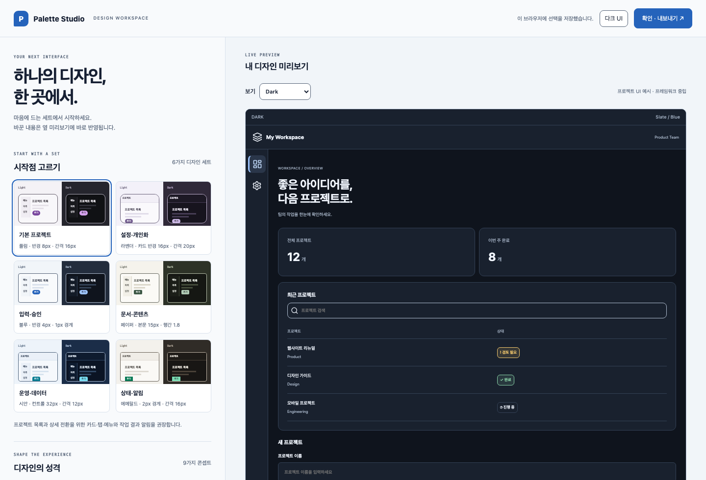 |

| 글꼴을 다듬는 작업실 | 모바일 작업실 |
|---|---|
| 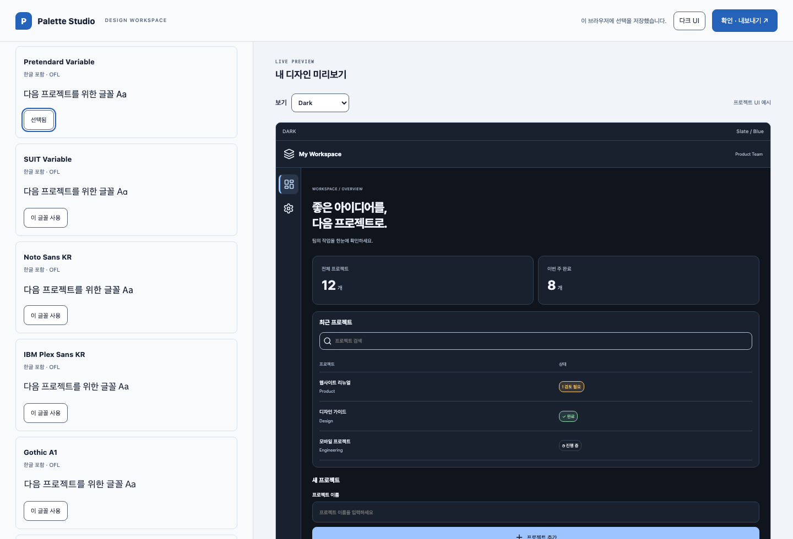 | 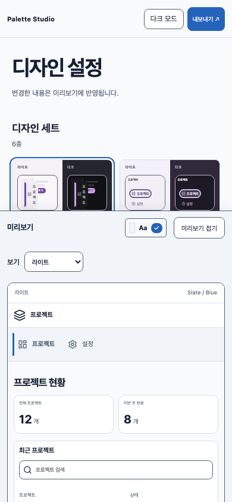 |

| 콘셉트 비교 | 실제 로컬 Base UI · Light/Dark |
|---|---|
| 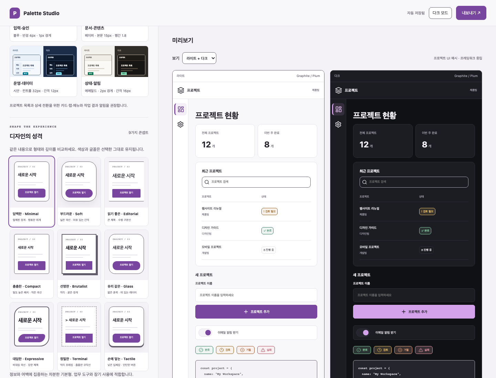 | 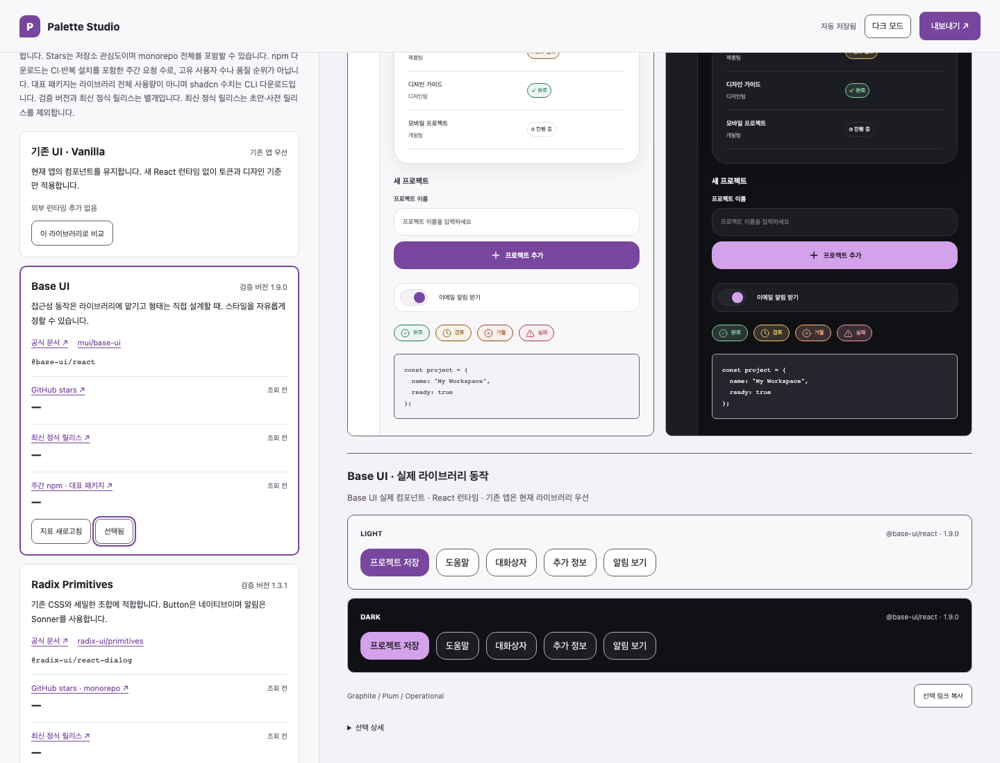 |

| 제목·설명·작업이 있는 알림 | 실제 메트릭의 캐시 표시 |
|---|---|
| 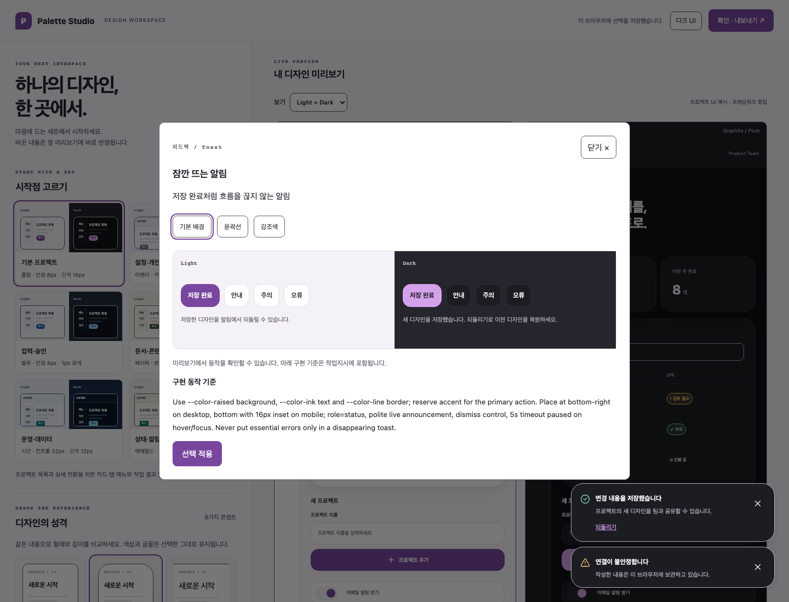 | 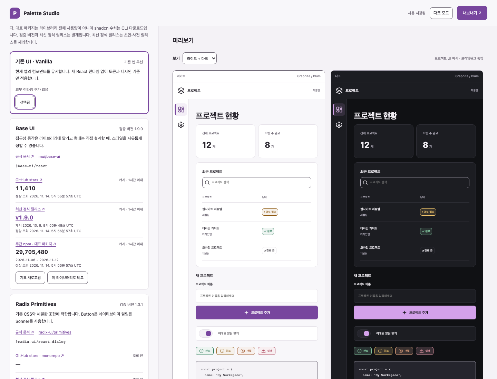 |

메트릭 이미지는 `previews/library-metrics-observation.json`의 실제 2026-11-14 공개 API 응답을 오프라인 캐시로 다시 표시한 화면입니다. 현재 실시간 수치라는 뜻은 아닙니다. [다크 지표](previews/studio-library-metrics-dark.png) · [모바일 지표](previews/studio-library-metrics-mobile.png) · [모바일 팝오버](previews/studio-popover-mobile.png) · [Radix](previews/studio-library-radix.png) · [React Aria](previews/studio-library-react-aria.png) · [MUI](previews/studio-library-mui.png) · [Mantine](previews/studio-library-mantine.png)

[라이브러리 내보내기 안내](previews/studio-export-desktop.png) · [모바일 내보내기](previews/studio-export-mobile.png): 화면에는 선택 라이브러리·적용 범위·필요 런타임만 간결하게 표시하고, 전체 기술 지침은 `library-README.md`로 저장합니다.

독립 실행 도구의 추가 화면:

| 디자인 도감 | 컴포넌트 Light / Dark |
|---|---|
| 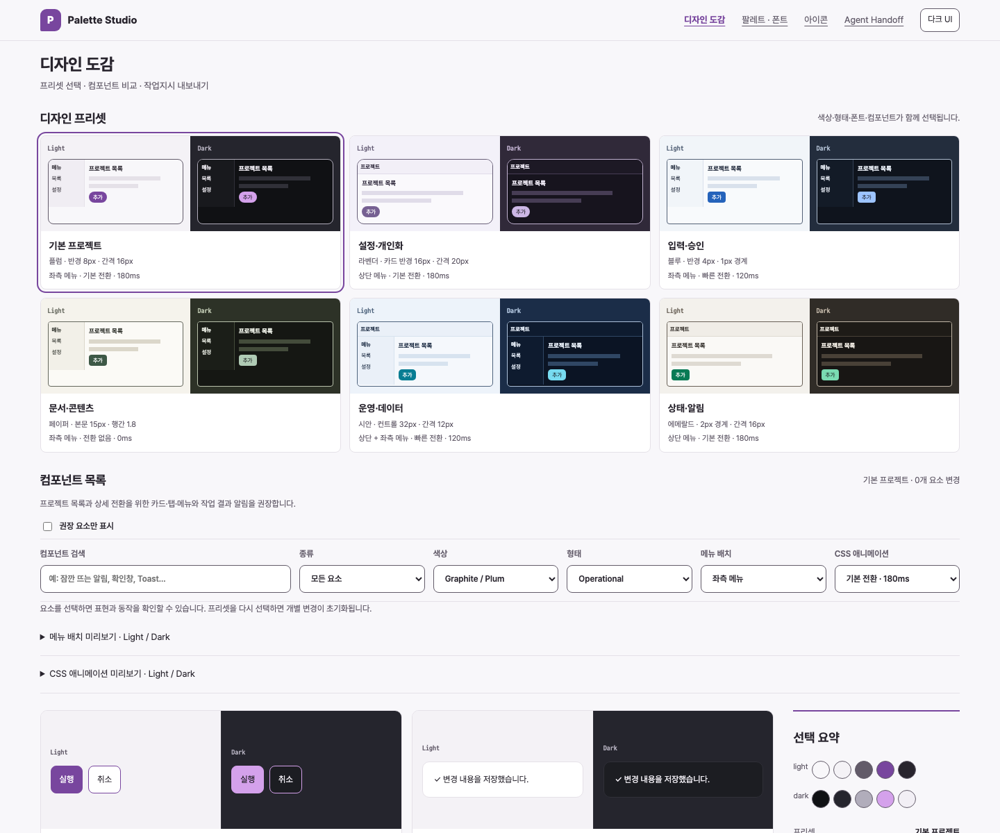 | 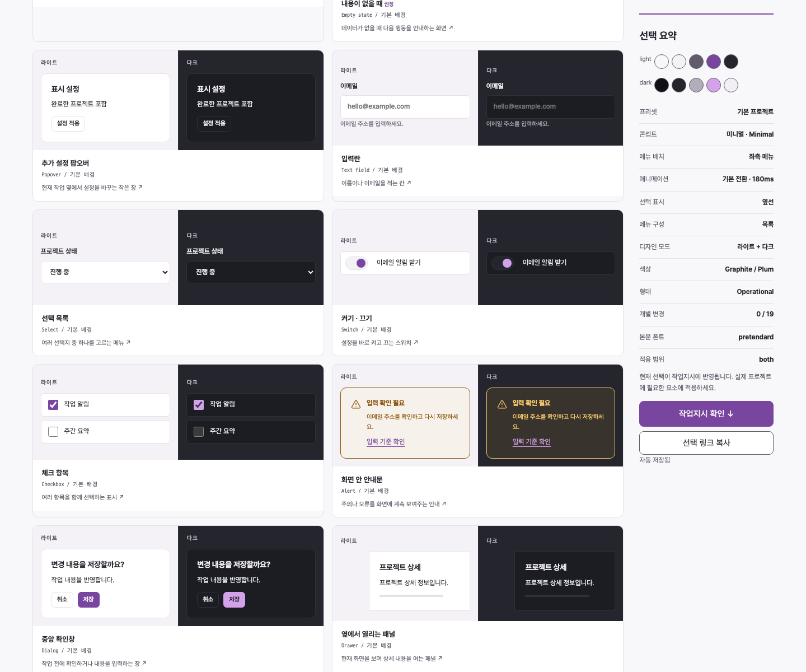 |

| 요소 상세 | 모바일 도감 |
|---|---|
| 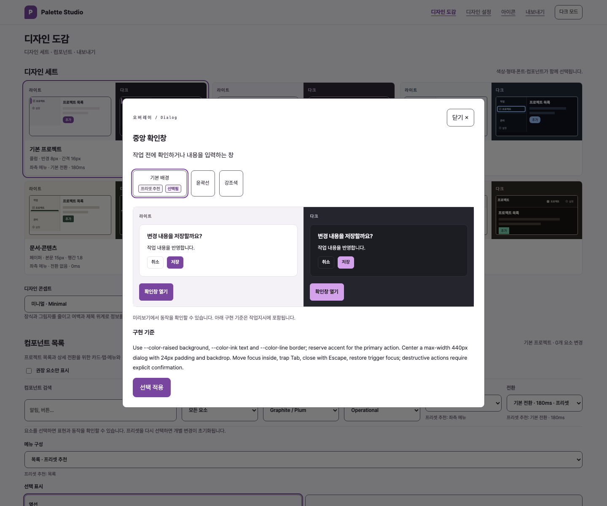 | 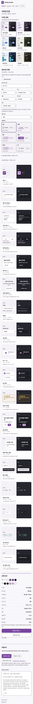 |

| 아이콘 | 에이전트 핸드오프 |
|---|---|
| 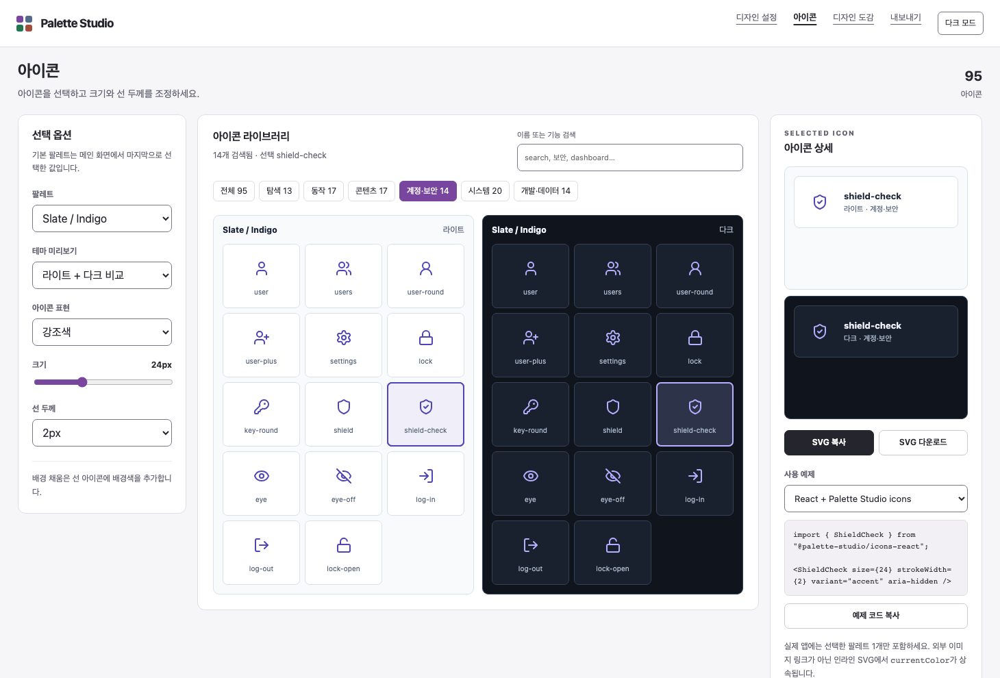 | 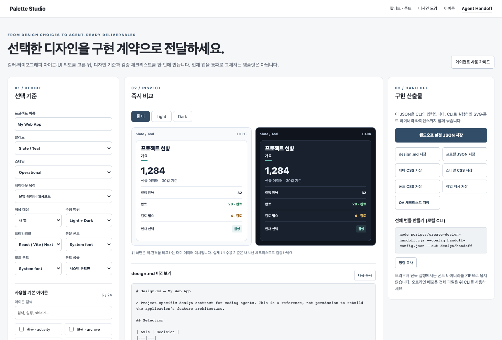 |

[메뉴 배치](previews/design-catalog-layout.png) · [애니메이션](previews/design-catalog-motion.png) · [도구 다크 UI](previews/design-catalog-ui-dark.png)

추가 캡처: [폰트 선택](previews/studio-fonts-desktop.png), [모바일 팔레트](previews/studio-mobile-light.png), [모바일 아이콘](previews/icon-studio-mobile.png), [모바일 핸드오프](previews/agent-handoff-mobile.png).

## 프로젝트에 적용

기존 앱의 컴포넌트·테마 설정·폰트 로더를 우선 사용하고, 선택한 토큰을 해당 구조에 연결합니다. `dark-only`는 기존 라이트 색상을 유지합니다. 색상 토큰 선언은 모드별 단일 HEX 값으로 두고, 컴포넌트에서 `var(--color-...)`로 소비합니다.

작업지시와 프로필을 함께 전달하고, 대상 저장소에 있는 `AGENTS.md`는 유지합니다. 지침을 추가하려면 [병합 예시](agents/ROOT-AGENTS-SNIPPET.md)를 참고하세요.

프로젝트 예시의 데이터와 저장 동작은 시연용입니다. 라이브러리 지표만 명시적 새로고침으로 실제 공개 API에 연결합니다. 정적 색상 대비 검사 결과는 전체 앱의 접근성 검증을 대체하지 않으며, 실제 화면의 키보드·상태·모바일 레이아웃을 별도로 확인해야 합니다.

## 파일 구성

| 경로 | 역할 |
|---|---|
| `catalog.html`, `catalog.js`, `css/catalog.css` | 디자인 세트와 컴포넌트 도감 화면 |
| `library-metrics.js`, `library-workspace.js` | 소스별 메트릭 캐시·명시적 조회·실제 라이브러리 작업실 |
| `examples/library-preview/`, `data/ui-libraries.js` | 실제 패키지 원본·잠금 버전·공유 내보내기 레시피 |
| `data/design-concepts.js` | 독립 콘셉트 9종, 공유 CSS·구현 기준 |
| `component-demos.js` | 툴팁·토스트·메뉴·팝오버·모달 수명과 접근성 |
| `data/design-catalog.js` | 세트·요소·표현 정의, 선택 검증, 작업지시 규칙 |
| `index.html`, `workspace.js`, `css/workspace.css` | 통합 편집·프로젝트 미리보기·확인 및 내보내기 |
| `catalog.js` | 공통 선택 상태·프리셋·컴포넌트 동작 |
| `app.js`, `css/studio.css` | 이전 단계형 편집기의 보존 소스 |
| `handoff.html`, `handoff.js`, `data/handoff-core.js` | 핸드오프 설정과 공용 생성기 |
| `scripts/create-design-handoff.cjs` | 오프라인 핸드오프 CLI |
| `css/palettes/`, `data/palettes.json` | 팔레트별 CSS와 실제 색상 데이터 |
| `css/foundation.css`, `css/styles/` | 선택적 컴포넌트 예제와 스타일 변수 |
| `css/utilities.css`, `css/tailwind-v4.css` | 일반 CSS / Tailwind v4 의미 유틸리티 |
| `font-loader.js`, `data/fonts.json`, `assets/fonts/` | 폰트 로더·카탈로그·WOFF2·라이선스 |
| `assets/icons/`, `data/icon-parts/`, `packages/icons-react/` | SVG 원본·브라우저 카탈로그·React 패키지 |
| `agents/`, `docs/`, `examples/` | 적용 계약·사용 지침·프레임워크별 예제 |
| `previews/`, `scripts/capture-previews.cjs` | 실제 브라우저 캡처와 생성 스크립트 |

## 개발·검증

키트 수정에는 Python 3.10+와 Node 18+가 필요합니다. 브라우저 검사에는 Playwright와 Chromium, 팔레트 보드 생성에는 Pillow를 사용합니다.

```bash
python3 scripts/vendor_fonts.py
python3 scripts/audit-fonts.py
python3 scripts/build.py
node scripts/audit.mjs
python3 scripts/bundle.py
node scripts/check-handoff-schemas.cjs
node scripts/test-design-handoff.cjs
node scripts/test-design-catalog.cjs
node scripts/test-design-concepts.cjs
node scripts/test-ui-libraries.cjs
node --test scripts/test-library-metrics.cjs
```

Playwright가 설치된 환경에서 실행합니다.

```bash
node scripts/check-studio-flow.cjs
node scripts/check-fonts.cjs
node scripts/check-icon-studio.cjs
node scripts/check-handoff-browser.cjs
node scripts/check-catalog-browser.cjs
node scripts/check-component-concepts.cjs
node scripts/check-component-gallery.cjs
node scripts/check-library-browser.cjs
node scripts/check-library-selection.cjs
node scripts/check-library-export-summary.cjs
node scripts/check-library-metrics-browser.cjs
node scripts/capture-previews.cjs
node scripts/check-screenshot-freshness.cjs
```

## 문서·라이선스

- [통합 방법](docs/INTEGRATION.md), [에이전트 워크플로](docs/AGENT-WORKFLOW.md), [디자인 원칙](design.md), [검증 범위](docs/VERIFICATION.md)
- [폰트 카탈로그](docs/FONT-CATALOG.md), [폰트 라이선스](docs/FONT-LICENSES.md), [아이콘 사용 규칙](docs/ICON-KIT.md)
- 코드와 자체 산출물: [LICENSE](LICENSE). 폰트: 각 OFL 라이선스. Lucide SVG: 동봉 라이선스와 고정된 공식 원본.
- 외부 자료와 출처: [THIRD-PARTY-NOTICES.md](THIRD-PARTY-NOTICES.md), [PROVENANCE.md](docs/PROVENANCE.md).
