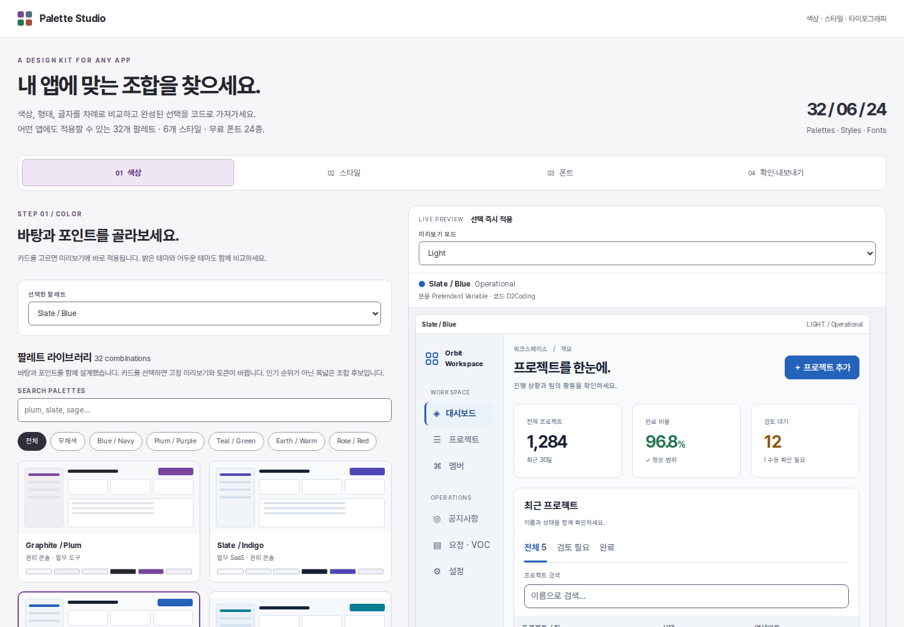

# Palette Studio · UI Color & Style Kit

32개 컬러 조합, 64개 라이트·다크 테마, 6개 디자인 스타일과 사내·상업용으로 사용할 수 있는 OFL 폰트 24종을 선택하는 디자인 레퍼런스입니다. 특정 프레임워크나 UI 라이브러리에 종속되지 않습니다.

## 먼저 열 파일

**`START-HERE.html`을 브라우저에서 여세요.** 기본은 CDN 우선이며 차단·오프라인일 때 내장 폰트로 폴백합니다. 서버나 설치 없이 사용할 수 있습니다. 폴더를 분리해도 이 HTML 하나로 팔레트 선택·비교·검색·내보내기가 동작합니다. iOS 파일 미리보기에서 스크립트가 제한되면 데스크톱 브라우저로 여세요.

1. 팔레트를 고릅니다. `Light + Dark` 또는 `두 팔레트 비교`로 같은 화면을 비교합니다.
2. 색상과 별도로 스타일을 고릅니다. Operational / Soft / Outline / Editorial / Compact / Clear Boundaries.
3. **폰트**에서 본문용 15종과 코드용 9종을 별도 목록에서 선택합니다. 역할별 검색·한글 지원·실제 글자·라이선스를 비교할 수 있습니다.
4. **확인·내보내기**에서 선택 요약, 새 앱/기존 앱, 컬러 변경 범위를 확인하고 CSS·JSON·작업지시를 저장합니다. 새 선택은 새 앱 / 라이트+다크가 기본입니다.
5. **CSS 저장**, **디자인 프로필 저장**, **작업지시 저장**을 각각 누릅니다. 이 세 파일과 키트 폴더를 OpenCode에 전달하세요.

큰 화면은 선택 패널 옆에 미리보기가 고정되며, 작은 화면은 하단 미리보기의 **크게 보기**로 확장할 수 있습니다. 단계는 자유롭게 왕복하고 선택값은 유지됩니다.

웹 미리보기는 공통 프로젝트 대시보드입니다. 프로젝트 추가는 모달 시연입니다. 실제 API 연결은 없습니다. 선택값은 로컬 브라우저 저장소와 URL fragment에 저장합니다. CDN 모드에서는 선택한 폰트와 보이는 견본에 필요한 WOFF2만 요청하며, 선택 프로필이나 앱 데이터는 전송하지 않습니다. `이 선택 링크 복사`는 같은 파일에 접근할 수 있는 환경에서 선택값을 재현합니다. 파일 자체를 원격으로 공유하는 기능은 아닙니다.

## 구성

| 경로 | 용도 |
|---|---|
| `START-HERE.html` | 단독 실행 가능한 전체 미리보기 |
| `index.html`, `app.js`, `css/studio.css` | 수정 가능한 미리보기 원본 |
| `css/palettes/` | 팔레트별 단일 CSS, 각 파일에 두 모드 포함 |
| `css/palettes.css` | 미리보기용 전체 테마; 제품에는 선택한 테마만 사용 |
| `css/foundation.css` | 선택적 `.cp-scope` 컴포넌트 스타일 예제 |
| `css/styles/`, `css/styles.css` | 색상과 독립적인 6개 스타일 |
| `css/utilities.css` | 일반 CSS용 의미 유틸리티 945개 |
| `css/tailwind-v4.css` | Tailwind v4용 동일 유틸리티, hover/focus variant 지원 |
| `font-loader.js`, `data/fonts.json` | CDN·동봉·시스템 폴백과 검증된 폰트 카탈로그 |
| `assets/fonts/` | OFL 폰트 24종의 원본 WOFF2와 라이선스 전문 |
| `css/fonts-cdn.css`, `fonts-local.css` | JS 없이 쓸 수 있는 기본 폰트 CSS |
| `docs/FONT-CATALOG.md`, `FONT-LICENSES.md` | 전체 후보·추천 용도·라이선스 확인표 |
| `css/primitives.css` | 탐색용 44개 × 11단계 원시 램프와 raw 유틸리티 |
| `data/palettes.json`, `tokens.csv` | 모든 테마의 직접 HEX 데이터 |
| `data/design-tokens.json` | sRGB 구조화 색상 교환 JSON; 벤더 자동 호환 보증 없음 |
| `data/tokens.json` | 토큰과 유틸리티 클래스 매핑 |
| `data/profile.schema.json` | 내보낸 디자인 프로필 구조 |
| `data/contrast-pairs.json`, `audit-results.json` | 정적 대비 검사 정의와 전체 결과 |
| `docs/` | 팔레트·스타일·CSS·통합·출처·검증 가이드 |
| `agents/` | 적용 계약, 비교 지시, 적용 지시, 결정 기록 양식 |
| `examples/` | Vanilla HTML / React TSX / Tailwind CSS 예제 |
| `previews/` | 정확한 색상값으로 그린 정적 팔레트 보드 PNG |
| `reference/` | 이전 Indigo 참고 토큰·검사 규칙 원문 보존본; 앱 import 금지 |
| `scripts/` | 생성·정적 검사·오프라인 HTML 빌드·보드 렌더링 |

## 이전 팔레트의 출처와 연결

`graphite-plum`은 이전에 합의한 핵심값을 유지합니다.

| 토큰 | Light | Dark |
|---|---|---|
| `--color-accent` | `#78469E` | `#D4A1EB` |
| `--color-accent-strong` | `#623680` | `#EAC7F6` |

다크 배경 앵커는 canvas `#101114`, raised `#1C1D22`, surface `#25252D`, shell `#18191D`, line `#303038`입니다. **라이트의 전체 토큰은 이번 키트용 보완안**입니다. 사내 저장소의 현재 라이트 팔레트를 추출한 파일이 아닙니다. 기존 앱에서 라이트를 보존하려면 다크 범위로 내보내세요.

신규 프로필은 `existing-app` / `new-app`을 사용합니다. 이전 `target=existing-gate` 링크는 기존 앱으로 이관되며 명시한 scope를 유지합니다. 과거 프로필은 스키마 호환을 유지합니다.

이전에 만든 `Graphite & Indigo | Reference palette`는 `graphite-indigo-reference`에 핵심값을 옮겼습니다. 전체 이전 토큰 이름을 포함하면서 별칭은 직접 HEX로 풀고, 지원 역할과 검사 쌍을 보완했습니다. Slate와 나머지 30종은 이번에 작성한 후보입니다. 기존 Gate의 전체 최신 소스·클래스 이름을 확인했다는 뜻은 아닙니다. 상세 이력: `docs/PROVENANCE.md`.

## 제품에 적용

단순 재사용은 색 토큰만 병합하면 됩니다. 기존 React 컴포넌트나 Tailwind 체계를 `foundation.css`로 교체할 필요가 없습니다. 예제 컴포넌트는 참고용입니다.

```css
/* 신규 앱 예시. 제품에는 하나의 팔레트만 포함합니다. */
@import "./palette-studio/css/fonts-cdn.css";
@import "./palette-studio/css/palettes/graphite-plum.css";
@import "./palette-studio/css/foundation.css";
@import "./palette-studio/css/styles/operational.css";
@import "./palette-studio/css/utilities.css";
```

```html
<html data-theme="dark">
  <body class="cp-scope" data-style="operational">
    <button class="ui-btn ui-btn-primary">프로젝트 추가</button>
  </body>
</html>
```

`foundation.css` 뒤에 스타일을 불러오세요. `utilities.css`와 `tailwind-v4.css`는 대체 관계입니다. 기존 앱에는 이 예제를 그대로 추가하지 말고 `docs/INTEGRATION.md`의 기존 토큰 병합 경로를 사용하세요.

## OpenCode에 전달

키트의 `AGENTS.md`는 이 폴더 자체의 운영 규칙입니다. 앱 저장소에 이미 있는 `AGENTS.md`를 덮어쓰지 마세요. `agents/ROOT-AGENTS-SNIPPET.md`의 짧은 참조문을 앱의 기존 지침에 병합하거나, 작업지시에서 파일 경로를 명시하세요. `agents/opencode.instructions.example.json`은 선택적 **병합 예시**이며 완성된 앱 설정이 아닙니다.

후보를 아직 못 정했다면 `agents/COMPARE-CANDIDATES.md`, 정했다면 `agents/APPLY-PROFILE.md`를 사용합니다. 에이전트가 매번 새 스타일을 발명하는 대신 선택 프로필과 실제 대표 화면을 기준으로 판단하게 합니다.

## 재생성·검사

미리보기 사용에는 런타임이 필요 없습니다. 키트를 수정할 때만 Python 3.10+와 Node 18+가 필요합니다. PNG 보드 재생성에는 Pillow가 추가로 필요합니다.

```bash
python3 scripts/vendor_fonts.py
python3 scripts/audit-fonts.py
python3 scripts/build.py
node scripts/audit.mjs
python3 scripts/bundle.py
python3 scripts/render_boards.py
```

일반 텍스트 쌍은 4.5:1, 지정한 입력 경계·포커스·차트와 같은 비텍스트 쌍은 3:1 기준으로 검사합니다. 장식용 카드 경계는 의도적으로 더 은은할 수 있습니다. 키트의 정적 통과가 전체 앱의 WCAG 준수를 의미하지는 않습니다. 차트에는 직접 라벨·패턴도 사용하세요.

사용 허락: `LICENSE`. 폰트는 각 OFL 라이선스로 동봉하며 `THIRD-PARTY-NOTICES.md`를 따릅니다. 브랜드 로고 원본이나 외부 아이콘 팩은 동봉하지 않습니다. 샘플의 작은 방패 표식은 이 키트의 CSS/SVG 예제이며 기존 브랜드 로고 원본이 아닙니다.

브라우저 캡처와 빌드·타입 검사 범위, 선택적 재현 명령은 `docs/VERIFICATION.md`에 있습니다. 에이전트 활용 방식은 `docs/WORKFLOW.md`를 참고하세요.

## 1.2.0 UI 개선

- 앱 중립적인 프로젝트 예시와 기본 프로필.
- 색상 → 스타일 → 폰트 → 확인·내보내기. 다운로드는 마지막 단계에만 표시.
- 데스크톱 sticky 미리보기 / 모바일 하단 고정·확대 미리보기.
- 본문·코드 폰트의 분리된 검색·목록·선택 상태, 스타일 카드와 검색 결과 없음 안내.



검사: `node scripts/browser-check.cjs` 또는 `node scripts/check-studio-flow.cjs`. CDN·동봉 폰트 검사는 `node scripts/check-fonts.cjs`입니다.
